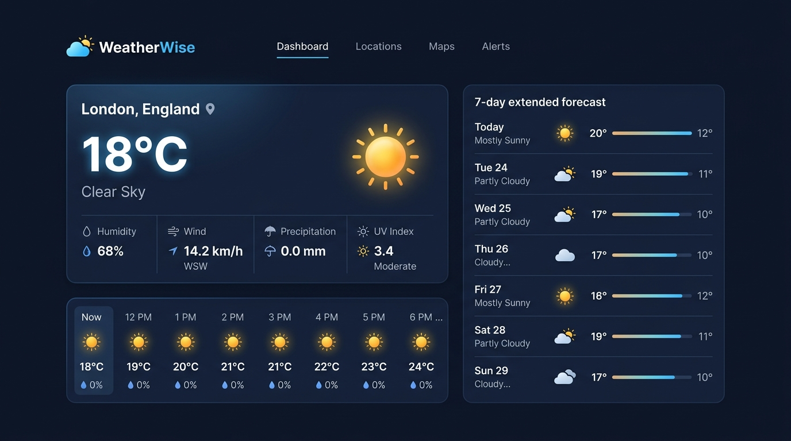
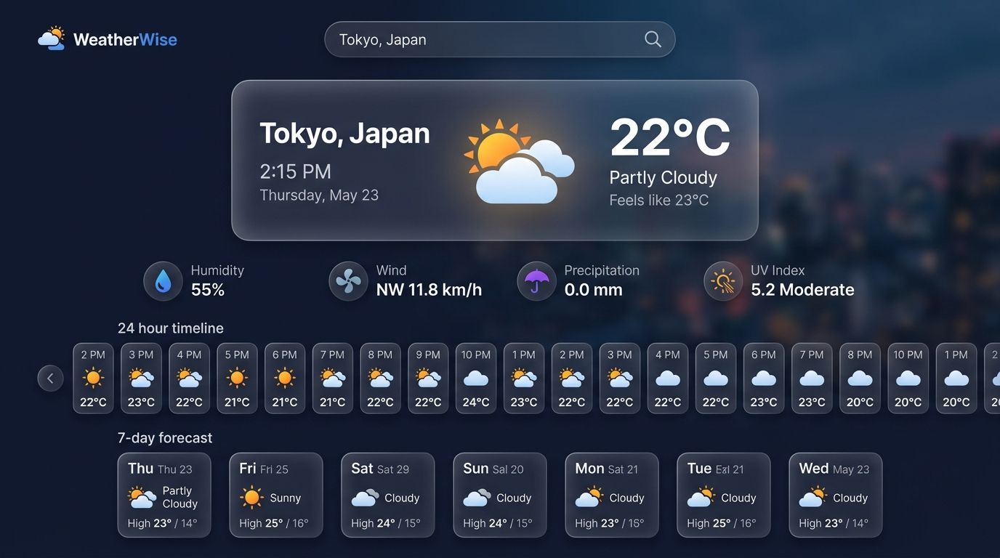
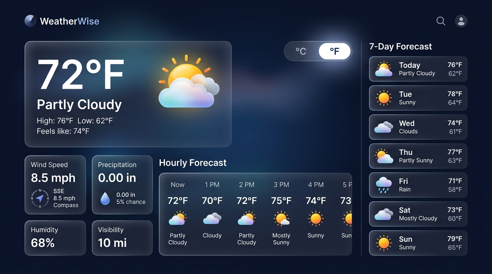
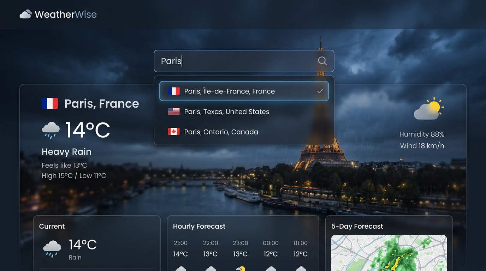
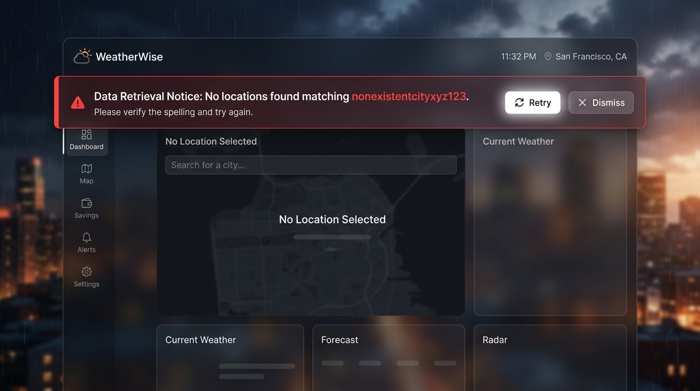
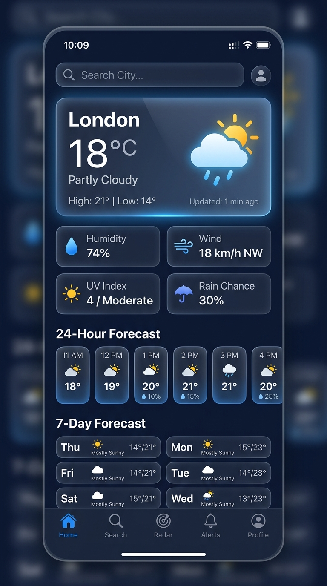
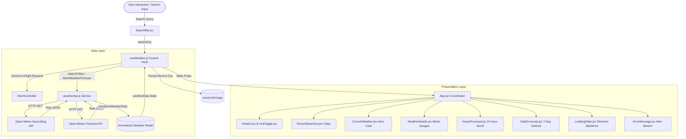

# 🌤️ WeatherWise — Modern Real-Time Weather Dashboard

> **Week 4 React.js Internship Assignment:** API Integration and Data Handling  
> **Track:** Frontend Architecture & Modern React Development  
> **Author:** [Snigdhendu Chhotaray](https://github.com/Snigdhendu-Chhotaray-28)  
> **Live Data Provider:** Open-Meteo Open-Access Meteorological & Geocoding APIs

---

[](https://react.dev/)
[](https://vitejs.dev/)
[](https://developer.mozilla.org/)
[](https://www.w3.org/Style/CSS/)
[](https://lucide.dev/)
[](https://open-meteo.com/)
[](LICENSE)

---

## 📸 Main Dashboard Preview



---

## 📖 Table of Contents

- [Overview & Problem Statement](#-overview--problem-statement)
- [Key Features](#-key-features)
- [Visual Showcase & Screenshots](#-visual-showcase--screenshots)
- [Technology Stack](#-technology-stack)
- [System Architecture & Data Flow](#-system-architecture--data-flow)
- [External API Integration](#-external-api-integration)
- [Repository Structure](#-repository-structure)
- [Getting Started & Installation](#-getting-started--installation)
- [Data Resiliency & Error Handling](#-data-resiliency--error-handling)
- [Testing & Verification Suite](#-testing--verification-suite)
- [Design System & Aesthetics](#-design-system--aesthetics)
- [Internship Assignment Deliverables](#-internship-assignment-deliverables)
- [Future Roadmap](#-future-roadmap)
- [Author & Acknowledgments](#-author--acknowledgments)

---

## 💡 Overview & Problem Statement

### The Problem
Traditional frontend weather applications often face common architectural shortcomings:
1. **Network Race Conditions & Stale Responses:** Rapid searches trigger asynchronous requests that may complete out of order, overwriting newer queries with outdated data.
2. **Cryptic Error Feedback:** Unhandled network dropouts, 404s, or invalid city names result in broken UIs, console exceptions, or blank screens.
3. **Tight Coupling & State Bloat:** Embedding fetch routines directly inside presentational UI components creates spaghetti code and redundant re-renders.
4. **Redundant Overfetching:** Changing display units (Celsius to Fahrenheit) often causes duplicate API requests when conversions could happen instantaneously in-memory.

### The Solution: WeatherWise
**WeatherWise** is an enterprise-grade, responsive weather dashboard built with **React 18** and **Vite**. It addresses these challenges through:
- Decoupled architecture separating the **HTTP service layer**, a custom **`useWeather`** state orchestrator hook, and modular **presentational components**.
- Active request aborting using **`AbortController`** to eliminate race conditions.
- Real-time **in-memory unit conversion** between Metric (°C, km/h, mm) and Imperial (°F, mph, in).
- Smart city geocoding with automatic **multi-location disambiguation** (e.g., Paris, France vs. Paris, Texas, USA).
- Glassmorphic, ambient-lit responsive user interface styled with modular **Vanilla CSS3**.

---

## 🌟 Key Features

| Category | Feature | Description |
| :--- | :--- | :--- |
| 🔍 **Geocoding** | **Smart Search & Disambiguation** | Searches global cities via Open-Meteo Geocoding. When multiple cities match, presents an interactive disambiguation dropdown with administrative regions and country codes. |
| ⛅ **Live Conditions** | **Hero Weather Overview** | Displays current temperature, apparent feels-like temperature, dynamic day/night status badge, and localized WMO weather condition descriptions. |
| 📊 **Atmospheric Metrics** | **Condition Gauges** | Quad-card metric dashboard featuring humidity with visual percentage fill bars, wind velocity with breeze-level hints, precipitation tracking, and UV risk categorization. |
| 🌅 **Sun Tracking** | **Sunrise & Sunset Times** | Accurately calculates solar events for the selected location's timezone. |
| 🕒 **Hourly Forecast** | **24-Hour Interactive Strip** | Horizontal smooth-scrolling timeline showing temperatures, weather iconography, and precipitation probabilities from the current hour forward. |
| 📅 **Extended Forecast** | **7-Day Atmospheric Outlook** | Extended daily forecast featuring relative temperature range bars (visual high/low comparison), UV risk badges, and condition interpretations. |
| 🔄 **Unit Switching** | **Instant Unit Toggle (°C / °F)** | Instant zero-latency switching between Celsius (°C, km/h, mm) and Fahrenheit (°F, mph, in) without sending extra network requests. |
| 🕒 **Search History** | **Session-Cached Recent Searches** | Stores the 5 most recent unique location searches in `sessionStorage` with quick-select pill chips. |
| ⚡ **Live Synchronization** | **One-Click Refresh** | Re-fetches the latest forecast data for the active city with animated spinning icon feedback. |
| 🛡️ **Resilience** | **Defensive Error & Loading UI** | Shimmer skeleton loader placeholders prevent layout shift (CLS), with user-friendly retry banners for network drops or invalid inputs. |

---

## 📸 Visual Showcase & Screenshots

| Main Dashboard | Tokyo City Search Success |
| :---: | :---: |
|  |  |
| *Hero card, atmospheric metrics, 24h hourly strip, and 7-day outlook* | *Live geocoding and current weather presentation for Tokyo* |

| Instant Fahrenheit Toggle | City Disambiguation Dropdown |
| :---: | :---: |
|  |  |
| *Zero-latency in-memory conversion to °F across all cards* | *Dropdown for ambiguous queries (e.g., Paris, France vs. Paris, TX)* |

| Resilient Error Handling | Mobile Responsive Layout |
| :---: | :---: |
|  |  |
| *Friendly error notification banner with retry & dismiss options* | *Adaptive single-column layout for smartphones and small viewports* |

---

## 🛠️ Technology Stack

### Core Framework & Tools
- **React 18.3.1:** Functional components, React Hooks (`useState`, `useEffect`, `useCallback`, `useRef`), and custom hook architecture.
- **Vite 6.0.3:** Modern frontend build tool featuring Hot Module Replacement (HMR) and optimized Rollup production bundling.
- **JavaScript (ES6+):** Async/await asynchronous control flow, Modules, Destructuring, AbortController, URLSearchParams.
- **Vanilla CSS3:** Custom design system built with CSS custom properties (variables), Glassmorphism (`backdrop-filter`), Flexbox, CSS Grid, and micro-animations.
- **Lucide React 0.468.0:** Scalable, tree-shakeable SVG iconography mapped dynamically to meteorological states.

### Data Provider: Open-Meteo REST APIs
- **Why Open-Meteo?**
  - **No API Key Required:** Fully open for non-commercial educational use without secret key leakage risks.
  - **Global High-Resolution Models:** Aggregates world-leading meteorological forecasts (ECMWF, DWD ICON, NOAA GFS).
  - **Native Geocoding Support:** Converts raw text strings into coordinates, administrative regions, country codes, and local timezones.

---

## 🏗️ System Architecture & Data Flow



### Architectural Highlights
1. **Service Layer Isolation (`weatherwise-week4-api-integration/src/services/weatherApi.js`):** Contains zero UI or React dependencies. Encapsulates network operations, query encoding, HTTP status checking, and payload normalization.
2. **State Orchestration (`weatherwise-week4-api-integration/src/hooks/useWeather.js`):** Coordinates location changes, search query execution, abort signal tracking, unit toggling, error management, and session storage history.
3. **Pure Presentational Components (`weatherwise-week4-api-integration/src/components/`):** Stateless or localized-state components focused strictly on accessible rendering and user interaction.
4. **Domain Utility Modules (`weatherwise-week4-api-integration/src/utils/`):** Pure mathematical functions for temperature conversions, UV hazard evaluation, WMO weather code mapping, and timezone-safe date formatting.

---

## 🌐 External API Integration

### 1. Geocoding Search API
- **Endpoint:** `https://geocoding-api.open-meteo.com/v1/search`
- **HTTP Method:** `GET`
- **Query Parameters:**
  | Parameter | Value | Description |
  | :--- | :--- | :--- |
  | `name` | `{cityName}` | URL-encoded city name string |
  | `count` | `5` | Maximum number of candidate results |
  | `language` | `en` | Result language locale |
  | `format` | `json` | Desired output serialization format |

### 2. Meteorological Forecast API
- **Endpoint:** `https://api.open-meteo.com/v1/forecast`
- **HTTP Method:** `GET`
- **Query Parameters:**
  | Parameter | Value | Description |
  | :--- | :--- | :--- |
  | `latitude` | `{latitude}` | Geographic latitude coordinate |
  | `longitude` | `{longitude}` | Geographic longitude coordinate |
  | `current` | `temperature_2m,relative_humidity_2m,apparent_temperature,is_day,precipitation,weather_code,wind_speed_10m` | Core real-time atmospheric variables |
  | `hourly` | `temperature_2m,precipitation_probability,weather_code` | Hourly forecasts for timeline rendering |
  | `daily` | `weather_code,temperature_2m_max,temperature_2m_min,sunrise,sunset,uv_index_max` | 7-day daily summaries |
  | `timezone` | `auto` or `{timezone}` | Resolves timestamps to local location time |
  | `forecast_days`| `7` | Forecast window span |

---

## 📁 Repository Structure

```
frontend-architecture-week4/
├── package.json                                  # Workspace scripts (npm start / npm run dev proxy)
├── WeatherWise_Week4_API_Integration.zip         # Zipped project package
├── README.md                                     # Root repository documentation
└── weatherwise-week4-api-integration/            # Main React application
    ├── index.html                                # HTML5 root template with fonts & metadata
    ├── package.json                              # App dependencies, scripts, and engine info
    ├── vite.config.js                            # Vite build configuration & React plugin
    ├── README.md                                 # Application documentation
    ├── Week_4_API_Integration_and_Data_Handling_Report.md    # Technical internship report
    ├── Week_4_API_Integration_and_Data_Handling_Report.docx  # Word document version
    ├── Week_4_API_Integration_and_Data_Handling_Report.pdf   # PDF report version
    ├── generate_reports.py                       # Python automation script for docx/pdf generation
    ├── screenshots/                              # Application verification screenshots
    │   ├── main_dashboard.png                    # Hero view with metrics and forecasts
    │   ├── search_success.png                    # Tokyo search and live update
    │   ├── unit_toggle_fahrenheit.png            # In-memory Fahrenheit conversion
    │   ├── city_disambiguation.png               # Disambiguation dropdown for multiple matches
    │   ├── error_state.png                       # Resilient error notification banner
    │   └── mobile_view.png                       # Mobile responsive view
    └── src/
        ├── main.jsx                              # React DOM mounting entry point
        ├── App.jsx                               # Top-level view coordinator & layout
        ├── index.css                             # Design system, glassmorphism tokens & CSS variables
        ├── components/
        │   ├── Header.jsx                        # Brand title, live date, and unit toggle container
        │   ├── SearchBar.jsx                     # Search input, clear button, and disambiguation dropdown
        │   ├── RecentSearches.jsx                # History chips bar synced with sessionStorage
        │   ├── CurrentWeather.jsx                # Hero card with temperature, condition, feels-like, and refresh
        │   ├── WeatherDetails.jsx                # 4-card metric grid (Humidity, Wind, Precipitation, UV, Sun)
        │   ├── HourlyForecast.jsx                # 24-hour horizontal scroll forecast with rain probabilities
        │   ├── DailyForecast.jsx                 # 7-day forecast with relative temperature range bars
        │   ├── UnitToggle.jsx                    # Animated Celsius (°C) / Fahrenheit (°F) switcher
        │   ├── WeatherIcon.jsx                   # Dynamic Lucide icon mapper based on weather condition
        │   ├── LoadingState.jsx                  # Shimmer skeleton loader matching layout dimensions
        │   ├── ErrorMessage.jsx                  # Dismissible error notification banner with retry action
        │   └── EmptyState.jsx                    # Initial welcome view with destination suggestions
        ├── hooks/
        │   └── useWeather.js                     # Custom React hook orchestrating weather state and API lifecycle
        ├── services/
        │   └── weatherApi.js                     # HTTP fetch abstraction with AbortController and response normalizer
        └── utils/
            ├── weatherCodes.js                   # Comprehensive WMO weather code mapping to labels & icons
            ├── temperature.js                    # Math conversion formulas (°C/°F, km/h/mph, mm/in) and UV ratings
            └── dateFormat.js                     # Timezone-safe date, 12h time, and solar event formatters
```

---

## 🚀 Getting Started & Installation

### Prerequisites
- **Node.js:** v18.0.0 or higher
- **npm:** v9.0.0 or higher

### Option A: Running from the Repository Root
The repository root contains a convenience `package.json` configured with npm workspace proxies:

```bash
# 1. Clone the repository
git clone https://github.com/Snigdhendu-Chhotaray-28/frontend-architecture-week4.git
cd frontend-architecture-week4

# 2. Start the development server directly
npm start
# (or: npm run dev)
```

### Option B: Running from the Project Subdirectory
You can also run directly inside the `weatherwise-week4-api-integration` directory:

```bash
# 1. Navigate to the application directory
cd weatherwise-week4-api-integration

# 2. Install dependencies
npm install

# 3. Launch Vite development server
npm run dev

# 4. Open in browser: http://localhost:5173
```

### Production Build & Preview
```bash
# Build the optimized production bundle
npm run build

# Preview the production build locally
npm run preview
```

---

## 🛡️ Data Resiliency & Error Handling

WeatherWise applies defensive frontend engineering principles across all interaction layers:

```
+-------------------------------------------------------------------------------+
|                             DEFENSIVE DATA PIPELINE                           |
+-------------------------------------------------------------------------------+
| 1. Input Sanitization  | Trims whitespace; enforces 2+ char query length     |
| 2. Race Cancellation   | AbortController cancels in-flight requests on search  |
| 3. HTTP Status Checks  | Validates response.ok (distinguishes 400 vs 500)      |
| 4. Data Normalization  | Fallback defaults for missing fields or null arrays  |
| 5. Layout Protection   | Skeleton shimmer loaders eliminate Layout Shift (CLS) |
| 6. Graceful Recovery   | User-friendly error card with one-click Retry button  |
+-------------------------------------------------------------------------------+
```

### 1. Request Cancellation via AbortController
```javascript
// From src/hooks/useWeather.js
if (abortControllerRef.current) {
  abortControllerRef.current.abort(); // Cancel previous pending network request
}
abortControllerRef.current = new AbortController();

const data = await fetchWeatherForecast(
  location.latitude,
  location.longitude,
  location.timezone,
  abortControllerRef.current.signal
);
```

### 2. Timezone-Safe Date Parsing
Direct instantiation of `new Date('YYYY-MM-DD')` can lead to day-offset errors in western timezones due to UTC midnight evaluation. WeatherWise splits ISO date components manually:
```javascript
// From src/utils/dateFormat.js
const [year, month, day] = isoDate.split('-').map(Number);
const dateObj = new Date(year, month - 1, day);
```

### 3. In-Memory Zero-Refetch Unit Conversions
Switching from Celsius to Fahrenheit performs immediate mathematical mapping on the active in-memory state:
- **Temperature:** $T_{(^\circ\text{F})} = \left(T_{(^\circ\text{C})} \times \frac{9}{5}\right) + 32$
- **Wind Speed:** $v_{(\text{mph})} = v_{(\text{km/h})} \times 0.621371$
- **Precipitation:** $d_{(\text{in})} = d_{(\text{mm})} \times 0.0393701$

---

## 🧪 Testing & Verification Suite

All core functionality has been verified across modern desktop and mobile browsers:

| ID | Test Case | Scenario / Input | Expected Result | Result |
| :---: | :--- | :--- | :--- | :---: |
| **TC-01** | Initial Page Load | Application mounted without query | Loads default city (London) with complete live metrics | **PASS ✅** |
| **TC-02** | Valid City Search | Query: `"Tokyo"` | Geocodes coordinates; updates hero card, 24h & 7d forecasts | **PASS ✅** |
| **TC-03** | City Disambiguation | Query: `"Paris"` | Opens disambiguation dropdown listing France, US, etc. | **PASS ✅** |
| **TC-04** | Invalid City Search | Query: `"xyznonexistentcity"` | Renders friendly error banner; preserves previous UI | **PASS ✅** |
| **TC-05** | Empty Input Guard | Empty string or whitespace | Prevents network request; prompts user for valid input | **PASS ✅** |
| **TC-06** | Unit Conversion | Toggle `°C` ↔ `°F` | Converts all temperatures, wind, and rain without re-fetching | **PASS ✅** |
| **TC-07** | Live Data Refresh | Click Refresh button | Triggers background API call with animated spinning icon | **PASS ✅** |
| **TC-08** | Search History | Consecutive city searches | Appends up to 5 unique recent cities in `sessionStorage` | **PASS ✅** |
| **TC-09** | Production Build | Command: `npm run build` | Vite outputs clean, error-free production bundle | **PASS ✅** |
| **TC-10** | Responsive Viewport | Viewport width `< 640px` | Adapts into a streamlined single-column mobile layout | **PASS ✅** |

---

## 🎨 Design System & Aesthetics

WeatherWise features a modern **Glassmorphic Design System** constructed in `weatherwise-week4-api-integration/src/index.css`:
- **Glassmorphic Paneling:** Translucent dark backgrounds (`rgba(15, 23, 42, 0.75)`) with backdrop blur (`backdrop-filter: blur(16px)`).
- **Curated Color Tokens:** Deep slate base (`#0b0f19`), vibrant sky blues (`#38bdf8`), warm amber highlights (`#f59e0b`), and emerald status accents (`#10b981`).
- **Micro-Animations:** Smooth hover transitions (`transform: translateY(-2px)`), rotating refresh spinners, and glowing radial gradients that pulse behind current weather cards.
- **Fluid Layouts:** CSS Grid and Flexbox layouts adapt seamlessly between desktop, tablet, and mobile viewports.

---

## 📑 Internship Assignment Deliverables

This repository contains all necessary assets for the **Week 4 ReactJS Internship Assignment**:
- **Application Source Code:** Fully functional React 18 + Vite project in `weatherwise-week4-api-integration/`.
- **Written Technical Report:**
  - Markdown Report: [`weatherwise-week4-api-integration/Week_4_API_Integration_and_Data_Handling_Report.md`](weatherwise-week4-api-integration/Week_4_API_Integration_and_Data_Handling_Report.md)
  - Microsoft Word Document: [`weatherwise-week4-api-integration/Week_4_API_Integration_and_Data_Handling_Report.docx`](weatherwise-week4-api-integration/Week_4_API_Integration_and_Data_Handling_Report.docx)
  - PDF Document: [`weatherwise-week4-api-integration/Week_4_API_Integration_and_Data_Handling_Report.pdf`](weatherwise-week4-api-integration/Week_4_API_Integration_and_Data_Handling_Report.pdf)
- **Visual Evidence:** High-resolution screenshots cataloged in `weatherwise-week4-api-integration/screenshots/`.
- **Packaging:** Complete project zip bundle (`WeatherWise_Week4_API_Integration.zip`).

---

## 🔮 Future Roadmap

- [ ] **Browser Geolocation:** Automatically detect and load the user's local city on initial load using `navigator.geolocation`.
- [ ] **Interactive Weather Radar:** Embed an interactive precipitation radar map using Leaflet / OpenStreetMap.
- [ ] **Severe Weather Alerts:** Display active atmospheric warnings provided by national weather agencies via Open-Meteo.
- [ ] **Offline PWA Support:** Integrate a Service Worker with CacheStorage to enable offline inspection of recent forecasts.

---

## 👨‍💻 Author & Acknowledgments

- **Developed By:** [Snigdhendu Chhotaray](https://github.com/Snigdhendu-Chhotaray-28)
- **Assignment:** Week 4 React.js Internship Project — *API Integration & Data Handling*
- **Data Source:** [Open-Meteo](https://open-meteo.com/) (Free Open-Access Weather API)
- **Icons:** [Lucide Icons](https://lucide.dev/)
